# RentNGo - Vehicle Rental System

A Java Swing desktop application for managing vehicle rentals.

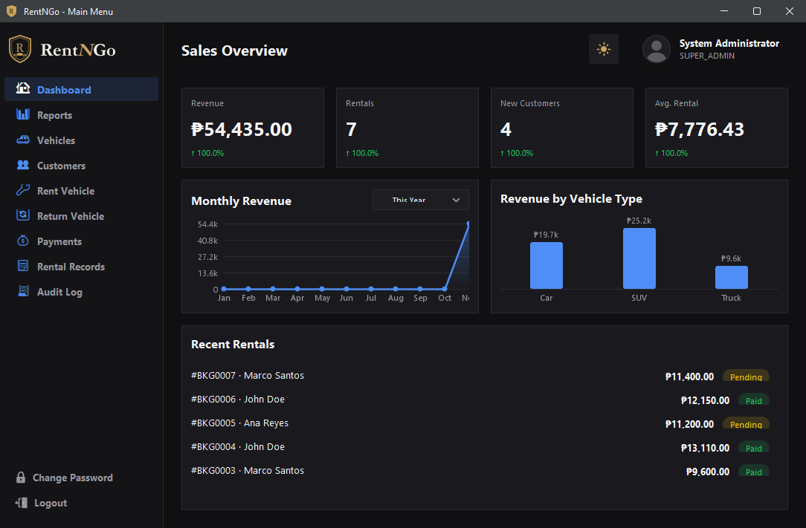

## Project Category

| | |
|---|---|
| **Project type** | Desktop GUI application (not a web or mobile app) |
| **Category** | Car Rental Management System |
| **Domain** | Vehicle rental and booking management (transportation / rental services) |
| **Language & UI** | Java with Java Swing (FlatLaf look and feel) |
| **Programming style** | Object-Oriented Programming: inheritance (`Vehicle` → `Car`, `SUV`, `Truck`, `Van`, `ElectricCar`; `User` → `Admin`, `Customer`), encapsulation, polymorphism and custom exceptions |
| **Architecture** | Layered: `model` (data classes), `service` (business logic), `gui` (screens) |
| **Data storage** | Plain text files (e.g. `vehicles.txt`), no database |

In short: **a Java Swing desktop application, a Car Rental Management System built with Object-Oriented Programming.**

## Screenshots

| Login | Reports |
|:---:|:---:|
| 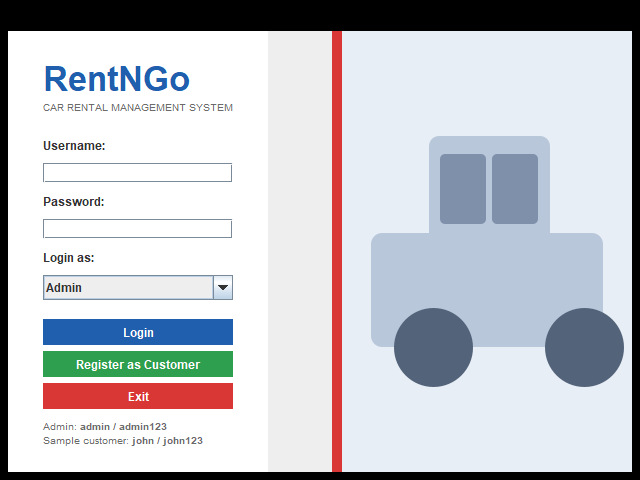 | 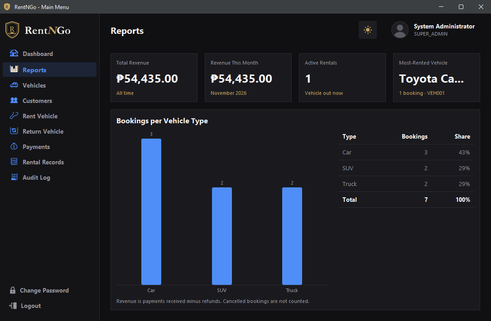 |
| **Manage Vehicles** | **Manage Customers** |
| 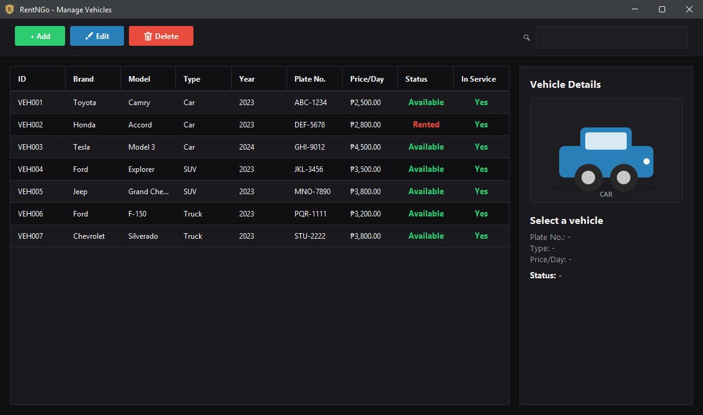 | 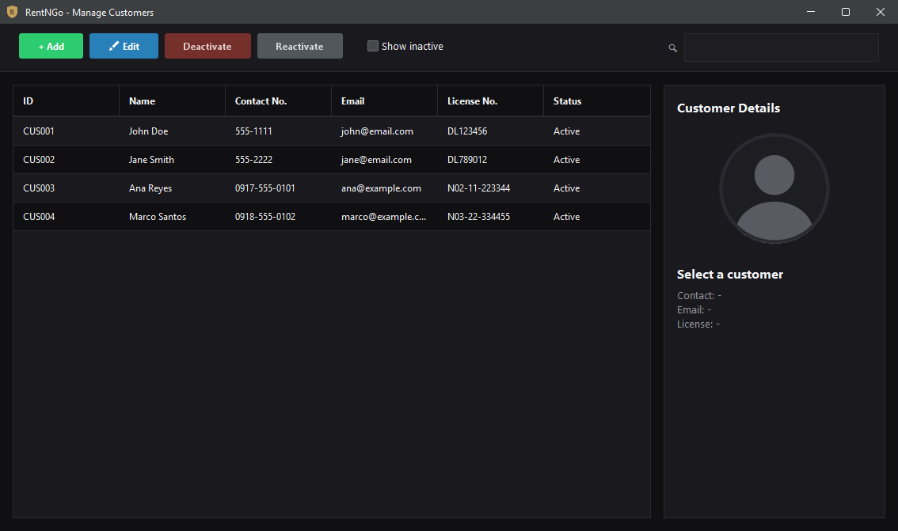 |
| **Rent Vehicle** | **Return Vehicle + payment** |
| 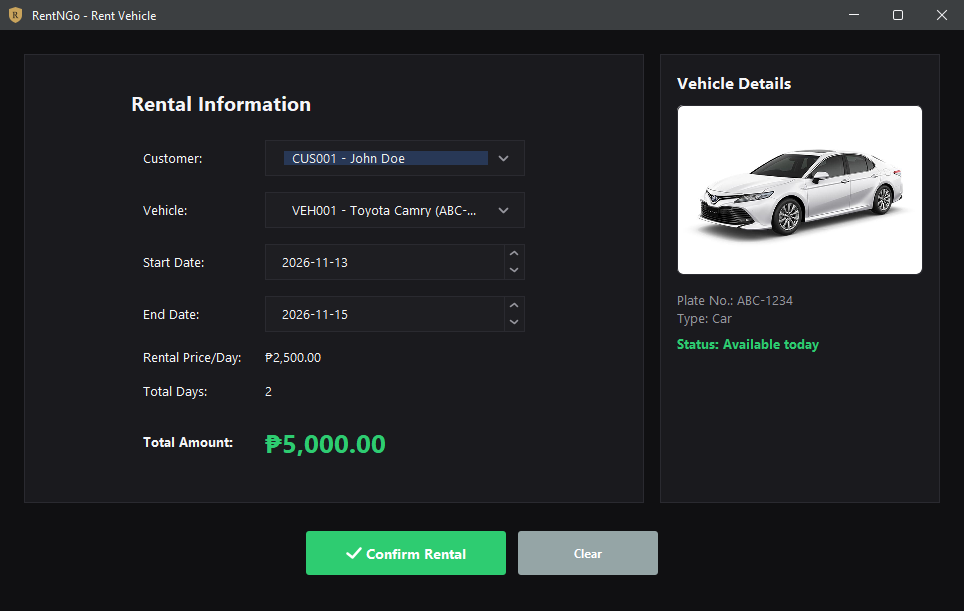 | 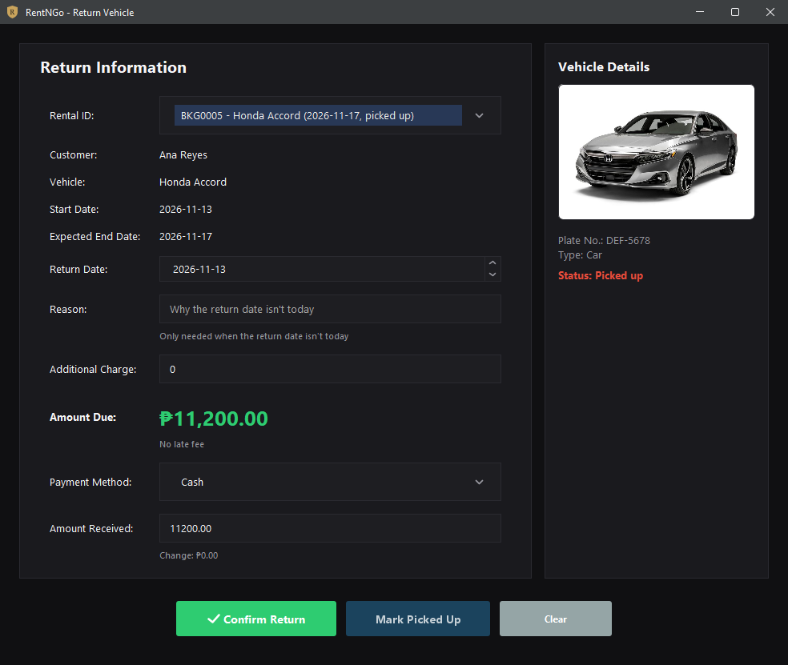 |
| **Payments** | **Rental Records** |
| 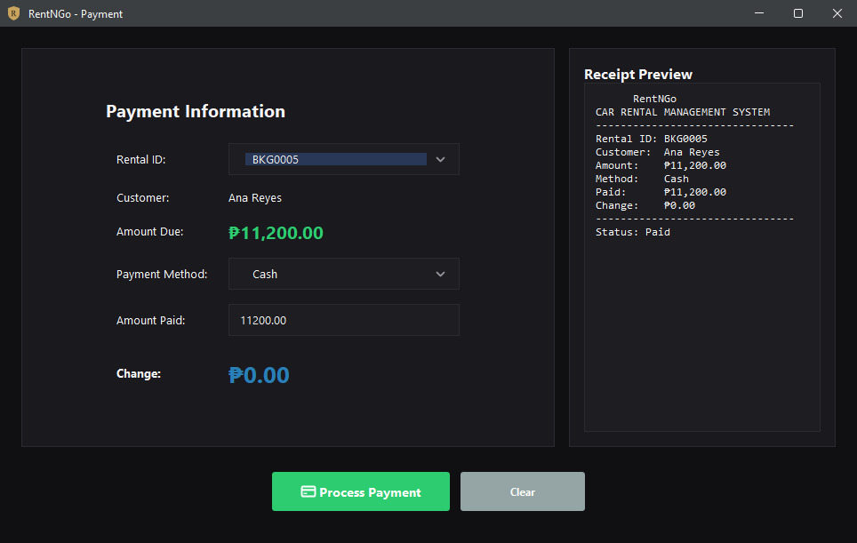 | 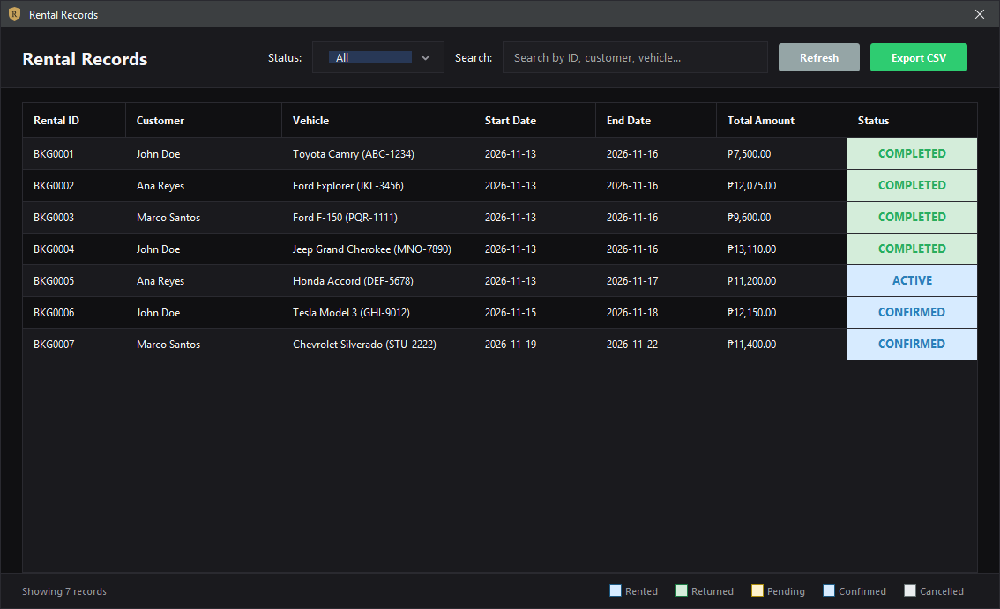 |
| **Audit Log** | **Customer Dashboard** |
| 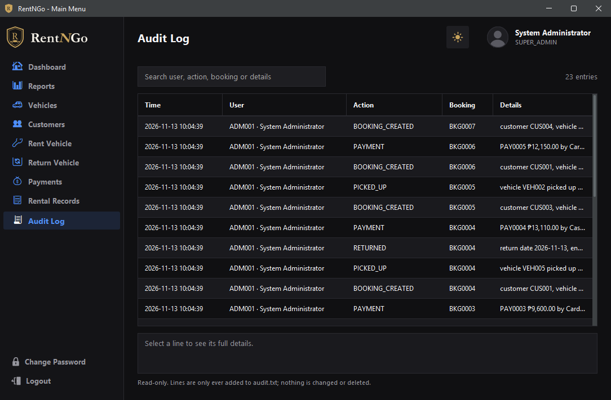 | 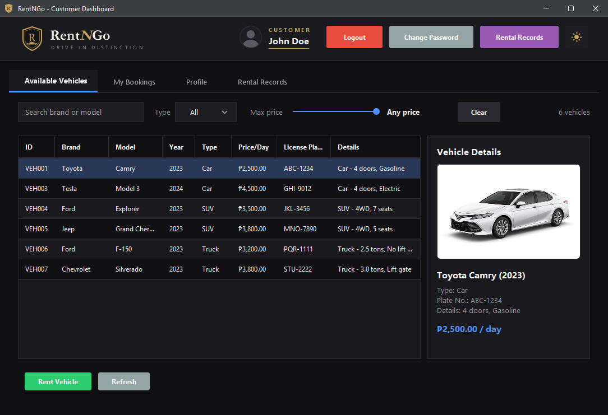 |
| **Light mode** | |
| 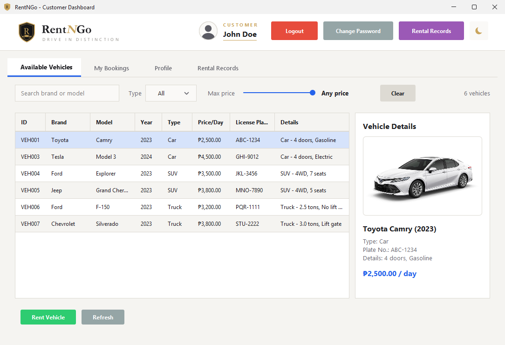 | |

## How to Run

**You need:** a JDK (Java Development Kit), version 17 or newer, not just a JRE. Check it in a
terminal: `javac -version` should print a version number. If it says "not found", install a JDK
(for example [Eclipse Temurin](https://adoptium.net/)) and open a new terminal.

**1. Get the code**

```bash
git clone https://github.com/Jaypicntrlio/RentNGo-.git
cd RentNGo-
```

Or on GitHub click **Code → Download ZIP** and unzip it.

**2. Start the app** (pick one)

- **Windows, easiest:** double-click `run.bat`. It compiles everything, then opens the login screen.
  From a terminal in the project folder: `.\run.bat`
- **VS Code:** open the project folder (or `RentNGo.code-workspace`), open `src/app/RentNGo.java` and
  press **F5**, or use Code Runner's **Run Code** ▷ button (the project settings make it build the
  whole project, not just one file).
- **Any system, by hand:** see [Building & Running](#building--running) below.

**3. Log in** with a demo account:

| Role     | Username | Password   |
|----------|----------|------------|
| Admin    | `admin`  | `admin123` |
| Customer | `john`   | `john123`  |

The `data/` folder (accounts, vehicles, bookings) is created on the first run, with the demo
accounts and vehicles in it. It isn't in Git, so every fresh copy starts with the demo data.

**Common problems**

- *"javac was not found"*: no JDK installed, or it isn't on PATH. Install one and reopen the terminal.
- *"package gui does not exist"*: something compiled only one file. Use `run.bat` or the full
  `javac` command below, which compile the whole `src/` folder.
- *"RentNGo is already running on this computer"*: close the other RentNGo window first.

## Features

- **User Authentication**: Login and sign-up for Admin and Customer roles. New admin accounts must be
  approved by an existing admin.
- **Login security**:
  - Passwords are stored as salted SHA-256 hashes with 100,000 rounds (`100000$salt$hash`). Older
    `salt$hash` values (10,000 rounds) still work and are upgraded automatically at the next login.
  - New passwords need at least 8 characters with a letter and a number (existing ones keep working).
  - After 5 wrong passwords a username is locked for 5 minutes ("Too many attempts. Try again in X
    minutes."); this also covers the approving-admin password when creating an admin account.
    Unknown usernames get the same message as wrong passwords.
  - **Change Password** is in both dashboards. Customers added by an admin start with a random
    10-character password, shown to the admin once, and must choose their own password before they can continue.
  - The demo passwords printed on the login screen (`admin123`, `john123`, `jane123`) must be changed at
    the first login, can't be chosen again, and can't approve new admin accounts.
  - Wrong-password counts and locks are saved in `data/lockouts.properties`, so restarting the app
    doesn't reset them.
- **Vehicle Management**: Add, edit, delete vehicles (Cars, SUVs, Trucks, Vans, EVs) with photos and an
  "In Service" switch for vehicles under maintenance.
- **Booking System**: Rent vehicles by date with automatic cost calculation; availability is
  worked out from bookings, so a vehicle can be booked for any free dates.
  - Rentals are at most 30 days, start at most 365 days ahead, and a customer can hold at most 3
    upcoming or active rentals at once (`BookingService.MAX_*`).
  - A vehicle can't be picked up while it is out of service or still out with a previous renter.
  - Only a picked-up rental can be returned. A booking that was never picked up shows no amount due in
    Return Vehicle (no rental or late fees are charged) and is cancelled instead, so it never earns
    loyalty points or a review.
  - A booking that hasn't been picked up can be cancelled by an admin in Return Vehicle → **Cancel Booking**,
    including a no-show (start date passed, never picked up). The screen shows the fee kept and the refund
    first; the refund is recorded as a payment, and no late fees are charged.
  - A vehicle's price and type can't change while it has upcoming or active bookings.
- **Returns & Payments**: Mark pick-ups and returns, automatic late fees, payments, refunds on
  cancellation, and receipts listing every payment and refund for the booking (Save as TXT).
- **Damage checklist at pick-up and return**: **Mark Picked Up** opens a short checklist (scratches,
  dents, fuel level, cleanliness and an optional note) that the admin fills in with the customer before
  handing over the keys. At return, **Return Checklist...** (right side of Return Vehicle) shows the
  same checklist with the pick-up answers beside it.
  - **Confirm Return** is refused until the return checklist is filled in (checked by `BookingService`
    too, not just the screen). Rentals picked up before this feature have no pick-up checklist and
    can still be returned without one.
  - Anything worse than at pick-up is listed as new, and the suggested charge fills in **Additional
    Charge**: ₱1,500 for new scratches, ₱3,000 for new dents, ₱500 per quarter tank less and ₱500 for
    cleaning (`VehicleCondition.*_CHARGE`). The admin can change the amount.
  - New damage is written to the Audit Log as **DAMAGE_FOUND**, with the suggested and the actual
    charge. Both checklists are also in the PICKED_UP and RETURNED entries.
  - Both checklists are shown side by side on the receipt ("*" marks what is new) and in Rental
    Records (**Pick-up Condition** and **Return Condition** columns, also in its CSV export). They are
    saved in `data/bookings.txt` (last two columns).
  - Card and GCash are charged the exact amount due; only Cash can be more (for change), by at
    most ₱100,000.
  - A payment must be for the booking's own customer.
  - **Cancellation policy**: cancelling less than 24 hours before the start date keeps a 20% fee
    (`BookingService.CANCELLATION_FEE_RATE`) of what was paid and refunds the rest; cancelling
    earlier refunds everything. The fee and refund are shown before the customer confirms.
    Every way of cancelling (customer, admin, or a status change in code) records the refund as a
    payment, so the booking, Payments and Reports always agree.
- **Admin Dashboard**: Revenue overview, manage vehicles, customers, rentals, returns, payments
  and rental records.
  - Revenue is counted the same way as in Reports: money received (payments minus refunds) in the
    month it was received, not the month the rental starts. A rental paid in November for December
    counts in November, and a refund comes off the month it was made. So the Dashboard's **Revenue**
    card always equals **Revenue This Month** in Reports, and the **Revenue by Vehicle Type** bars add
    up to **Total Revenue**. **Rentals** counts rentals starting this month; **Avg. Rental** is their
    average price, paid or not. Hover over a card to see what it counts.
- **Customer deactivation**: Customers are deactivated instead of deleted, so their bookings and
  payments keep their name. Deactivation is refused while they have a confirmed or picked-up rental
  or owe money (the message lists the bookings). Deactivated customers can't log in or book; an admin
  can reactivate them (Customers → Show inactive → Reactivate).
- **Audit Log**: Every booking, pick-up, return, payment, refund/cancellation, vehicle change,
  customer change (including deactivation) and new admin account is recorded in `data/audit.txt` with the time and the user
  who did it (sidebar → Audit Log: read-only, newest first, searchable). Lines are only ever added.
- **Backup and Restore** (admin sidebar):
  - **Backup** saves the whole `data/` folder as `backups/rentngo-YYYY-MM-DD-HHmm.zip` (beside `data/`).
    A second backup in the same minute gets `-2`, `-3` ... Profile photos in `images/` are not included.
  - **Restore** lists the backups, newest first (or **Choose Other File...** for one kept elsewhere).
    After you confirm, RentNGo:
    1. checks the whole backup first: it must be a RentNGo backup (it holds `rentngo-backup.txt`), with
       plain file names only and an accounts file someone can log in with. Otherwise nothing is changed;
    2. saves the current data as `rentngo-...-before-restore.zip`, so a restore can be undone by restoring
       that file;
    3. replaces the files in `data/` (if anything fails part-way, the old files are put back);
    4. restarts at the login screen, so every window loads the restored data.
  - A restore never runs while another copy of RentNGo has the data folder open: it needs the
    `data/.rentngo.lock` lock that this copy took at start-up.
  - Both are written to the Audit Log (**BACKUP_CREATED**, **DATA_RESTORED**). The restore is recorded in
    the log of the data it replaced (inside the "before-restore" backup) and in the restored log.
  - `backups/` holds the same private data as `data/` (password hashes, customers), so it is in
    `.gitignore`. Keep copies somewhere safe, e.g. a USB drive.
- **Promo codes**: Admins create discount codes in the sidebar → **Promo Codes** (code, % off, valid-until
  date, number of uses) and can delete them. Customers (Rent dialog) and admins (Rent Vehicle) type a code
  and press **Apply** to see the discounted total.
  - The discount comes off the rental cost only (late fees and extra charges are not discounted) and is
    shown on the receipt. Codes are not case-sensitive; 3 to 20 letters or numbers, 1% to 90% off.
  - An unknown, expired or used-up code stops the booking with a message. Each booking spends one use;
    cancelling the booking gives it back. Bookings keep their discount if the code is deleted later.
  - Every code has a permanent ID (PRM0001, ...) that its bookings remember. A code deleted and created
    again with the same name is a different code: cancelling an old booking gives nothing to the new one,
    and a customer who used the old code can use the new one.
  - Codes are saved in `data/promocodes.txt`; creating and deleting them is recorded in the Audit Log.
  - **Each customer can use a code once** ("You already used WEEKEND10 (BKG0001). One use per customer."),
    shown as soon as Apply is pressed; for an admin renting to a customer it checks the chosen customer.
    A cancelled booking doesn't count, so the code can be used again after cancelling.
  - Codes can't be found by guessing: after **5 wrong codes in a row** a customer can't check or use any
    promo code for **15 minutes** ("Too many wrong promo codes. Try again in X minutes."); a right code
    resets the count. Like the password lockout it survives a restart (`data/promo-attempts.properties`)
    and is recorded in the Audit Log. Admins aren't limited. Booking without a code still works.
- **Maintenance history**: Vehicles → select a vehicle → **Maintenance** lists every service with its
  date, work done, cost and next service date, and records a new one (admin only). Saving a record can
  also take the vehicle out of service. Records are saved in `data/maintenance.txt`, recorded in the
  Audit Log, and kept when a vehicle is deleted.
  - The service date can't be in the future, the cost is ₱0 to ₱1,000,000, and the next service date
    must come after the service date.
  - The vehicle list has a **Next Service** column (red when due), and the Admin Dashboard shows a red
    "Due for service" bar while any vehicle's next service date has passed.
- **Reports**: Total revenue, revenue this month, maintenance cost (all time and this month, with
  revenue minus maintenance), most-rented vehicle, active rentals and bookings per vehicle type
  (sidebar → Reports).
  - **Export CSV** (top right of Reports, admin only) saves a spreadsheet with the summary, revenue,
    maintenance, revenue minus maintenance and bookings for each of the last 12 months, and bookings per
    vehicle type. Amounts are plain numbers (e.g. 5000.00) so Excel can add them up; the ₱ is in the
    column headings. Each export is recorded in the Audit Log.
- **CSV export** (Rental Records): values are quoted with inner quotes doubled, values starting with
  `= + - @` (or a tab/return) get a leading `'` so Excel shows them as text instead of running a
  formula, and the file is UTF-8 with a BOM so ₱ displays correctly.
- **Permissions in the services**: every service method checks the logged-in user, whichever
  window calls it. Admin-only: payments, pick-ups, returns, status changes, vehicle and customer
  management. Customers can only book, cancel and edit for themselves, and only see their own data.
  Someone who must change their password can do nothing else first. Services hand out copies
  (never password hashes), so changing a returned object never changes saved data.
- **Privacy**: Customers only ever see (and export) their own rental records; admins see all.
  Logging out closes every window of the session, and admin tool windows check that an admin is
  still logged in before saving, paying, returning or deleting.
- **Customer Dashboard**: Browse available vehicles with search (brand/model), a type filter and a
  max price slider; click a column header to sort. Make and cancel bookings, view history.
- **Loyalty points**: Customers earn **1 point for every ₱100 paid**, given once a rental is both
  completed and fully paid (at the return if it was prepaid, otherwise with the last payment), never at
  booking. When renting (customer Rent dialog or admin Rent Vehicle), tick **Use N loyalty points**:
  each point takes ₱1 off, in steps of 100, after any promo code and never more than the rental costs.
  - When an **admin** spends a customer's points (Rent Vehicle), the customer agrees by typing their own
    password at the counter. Wrong passwords count towards that customer's login lockout. A customer still
    on the starting password the admin saw (or a demo password) must log in and choose their own first.
    Customers booking for themselves don't type anything extra.
  - Cancelling a booking gives its points back. The balance is on the customer's Profile tab and in the
    admin's customer list; the receipt shows points used and earned.
  - Points are saved with the account (`accounts.txt`, last column; older files load as 0 points), and
    every earn, spend and give-back is recorded in the Audit Log.
  - If the points can't be saved to the account when they are due (e.g. accounts.txt was changed by
    another program), they are never lost: the booking keeps them as **owed**, the admin gets a warning
    after the return or payment, and they are added automatically (once) the next time RentNGo starts.
    If they still can't be added, the start-up "data problem" message says so.
- **Ratings and reviews**: After a rental is completed, the customer selects it in My Bookings →
  **Rate Vehicle** and gives 1 to 5 stars with an optional comment (up to 300 characters). Each rental can
  be reviewed once, only by its own customer. The vehicle list shows each vehicle's average rating
  (e.g. ★ 4.5 (2)); **Read Reviews** under Vehicle Details lists the comments.
  - Admins see every review in the sidebar → **Reviews** and can **hide** an offensive one (and show it
    again). Hidden reviews don't count in the average and customers can't see them. Adding, hiding and
    showing reviews are recorded in the Audit Log. Saved in `data/reviews.txt`.
- **Favorite vehicles**: Customers click the ☆ in the first column (or **Add to Favorites** under Vehicle
  Details) to star a vehicle, and tick **★ Favorites** to show only starred ones, together with the
  other filters. Stars are saved per customer in `data/favorites.txt`, so they are still there after
  logging out. A deleted vehicle drops out of everyone's favorites.
- **Light / Dark mode**: Modern [FlatLaf](https://www.formdev.com/flatlaf/) look with a Light/Dark
  button on both dashboards. The choice is remembered; the login screen always stays dark.
- **Saved Data**: Everything is saved automatically to the `data/` folder.

## Vehicle Types & Pricing

Prices are in pesos (₱). Money is stored as `BigDecimal`, rounded to 2 decimals.

- **Car**: Base price, 10% discount for Electric vehicles
- **SUV**: 15% surcharge for 4-wheel drive
- **Truck**: 20% surcharge for load capacity > 5 tons
- **Van**: 10% surcharge for 12 or more seats (8 to 18 seats, with or without a sliding door)
- **EV** (Electric Car): 10% eco discount, the same as an electric Car. Battery range 100 to 1,000 km,
  with or without fast charging. The demo fleet has two (BYD Atto 3 and Nissan Leaf, VEH008 and VEH009);
  they are only added on a first run, so existing data is not changed. A Car saved with fuel type
  "Electric" (like the demo Tesla) stays a Car.

A rental is charged per day **between** the start and end dates (Mon → Tue is 1 day); the end
date must be after the start date. The end date is the **return day**, so availability uses the same
rule: a car booked 1st–5th can be booked again from the 5th (same-day handover), and two bookings
clash only if they share at least one day. A rental that is overdue and not yet returned blocks the
car through today. Returning after the end date adds a late fee of **1.5× the
daily rate** for each extra day.

## Booking Status Flow

```
PENDING ──► CONFIRMED ──► ACTIVE ──► COMPLETED
   │            │
   └────────────┴──────► CANCELLED
```

| From      | Can become            | How                                                        |
|-----------|-----------------------|------------------------------------------------------------|
| PENDING   | CONFIRMED, CANCELLED  | New bookings are created as CONFIRMED                       |
| CONFIRMED | ACTIVE, CANCELLED     | **Mark Picked Up** (Return Vehicle window, after the pick-up checklist), or cancel before the start date |
| ACTIVE    | COMPLETED             | **Confirm Return** (after the return checklist): adds late fee / extra charges, takes the payment (Cash, Card or GCash) and shows a receipt that can be saved as TXT. Records which admin processed it and when. A return date other than today needs a reason (at least 10 characters), saved with the booking and in the audit log |
| COMPLETED | — (final)             |                                                            |
| CANCELLED | — (final)             | Anything already paid is recorded as a refund               |

Any other change is rejected with a `BookingException`. A CONFIRMED rental that was never marked as
picked up can't be returned: mark it as picked up first, or cancel it if the customer didn't come.

## Libraries (`lib/`)

| Jar | Used for | Download |
|-----|----------|----------|
| `flatlaf-3.7.2.jar` | Modern look-and-feel, Light/Dark themes | [Maven Central](https://repo1.maven.org/maven2/com/formdev/flatlaf/3.7.2/flatlaf-3.7.2.jar) |
| `junit-platform-console-standalone-1.13.4.jar` | JUnit 5 tests (tests only) | [Maven Central](https://repo1.maven.org/maven2/org/junit/platform/junit-platform-console-standalone/1.13.4/junit-platform-console-standalone-1.13.4.jar) |

To add a jar yourself: create a `lib` folder next to `src`, download the jar into it, and include
`lib/*` on the classpath as shown below. FlatLaf is loaded by class name, so if its jar is missing the
app still runs with the plain Windows look (and prints a note); the Light/Dark colors still switch.

## Building & Running

Requires Java 17 or newer. Run these from the `RentNGo` folder.

```bash
# Compile all sources into out/
javac -encoding UTF-8 -cp "lib/*" -d out $(find src -name "*.java")

# Copy resources (login background image) next to the compiled classes
mkdir -p out/resources && cp -r src/resources/. out/resources/

# Run (the main class is app.RentNGo); lib/* puts FlatLaf on the classpath
java --enable-native-access=ALL-UNNAMED -cp "out;lib/*" app.RentNGo
```

On Windows PowerShell:

```powershell
javac -encoding UTF-8 -cp "lib/*" -d out (Get-ChildItem -Recurse src -Filter *.java).FullName
Copy-Item -Recurse -Force src\resources out\
java --enable-native-access=ALL-UNNAMED -cp "out;lib/*" app.RentNGo
```

On macOS/Linux use `:` instead of `;` in the classpath (`"out:lib/*"`). Keep the quotes around
`lib/*` so the shell doesn't expand it; Java expands it to every jar in `lib/`.
`--enable-native-access=ALL-UNNAMED` only silences a warning newer Java versions print when FlatLaf
loads its small native library for the window title bar.

In VS Code, open the `RentNGo` folder itself (not a parent folder), so its `.vscode/` settings are
used: they already add `lib/*.jar` to the project and set up **F5** (`.vscode/launch.json`) and Code
Runner. Then run `src/app/RentNGo.java`.

Images such as the login background are loaded from the classpath (`/resources/...`), so they
must be in `out/resources/` when running from `out`. If the login image is missing, the login
screen falls back to a plain gradient background.

Saved data (accounts, vehicles, bookings, payments, and the Light/Dark choice in
`settings.properties`) is kept in the `data/` folder and photos in `images/`; both are created
automatically on first run.

If a data file is damaged:

- **A bad line** is skipped on its own and reported at startup (e.g. `accounts.txt line 7 skipped:
  …`); everything else still loads. A `.corrupt-…` copy of the original file is kept, because the
  skipped lines are dropped the next time that file is saved.
- **Demo accounts and vehicles** are only created on the very first run, when the file doesn't exist.
  They are never created over an existing file.
- **A file that can't be read at all** (or an accounts file with no admin account) is left
  untouched: nothing is saved to it and changes are refused until it is fixed and RentNGo is
  restarted. If the accounts can't be loaded, the app shows the error and closes instead of
  opening the login screen.
- **Only one copy of RentNGo** can use the `data/` folder at a time: it holds a lock on
  `data/.rentngo.lock` while running (released on exit, or by the OS if it crashes). Starting a second
  copy shows "RentNGo is already running on this computer. Close the other window first."
- **A file changed on disk** after RentNGo loaded it (by another program or a hand edit) is never
  overwritten: the save is refused, RentNGo shows "Data was changed by another program. Please restart
  RentNGo.", and that part of the data stays read-only until you restart.
- **Booking and payment numbers** are saved as `#seq` lines (like the CUS/ADM account numbers), so
  a number is never handed out twice, even after a bad line is skipped.

### Tests

Compile the app first (above). The tests use temporary files, so your real `data/` folder is never
touched. (On macOS/Linux use `:` instead of `;` in the classpaths.)

**JUnit 5** (`test/service/`): BookingService (overlapping bookings, Car/SUV/Truck/Van/EV pricing, status
rules, late fees, who can see which bookings), ReportService, maintenance history (MaintenanceTest), promo codes
(PromoCodeTest), favorites (FavoritesTest), reviews
(ReviewTest), loyalty points (LoyaltyPointsTest), the Reports
CSV export (ReportExportTest), the damage checklist (DamageChecklistTest), backup and restore
(BackupRestoreTest), and recovery from damaged
data files (DataFileRecoveryTest).

```bash
javac -encoding UTF-8 -cp "out;lib/junit-platform-console-standalone-1.13.4.jar" -d test-out test/service/*.java test/gui/*.java
java -Drentngo.allowDemoPasswords=true -jar lib/junit-platform-console-standalone-1.13.4.jar execute -cp "out;test-out;lib/flatlaf-3.7.2.jar" --select-package service --select-package gui
```

`-Drentngo.allowDemoPasswords=true` lets the tests use the demo logins without the forced password
change (the app itself never sets it).

**Plain-Java tests** (`test/RentNGoTests.java`, no library needed):

```bash
javac -encoding UTF-8 -cp out -d test-out test/RentNGoTests.java
java -cp "test-out;out" RentNGoTests
```

## Project Structure

```
RentNGo/
├── src/
│   ├── app/
│   │   └── RentNGo.java              # Main entry point (opens saved data, shows login)
│   ├── model/                        # Data models
│   │   ├── User.java                 # Base user class (stores a password hash, never the password)
│   │   ├── Admin.java                # Admin user
│   │   ├── Customer.java             # Customer user
│   │   ├── Vehicle.java              # Base vehicle class (price, "In Service" flag, photo)
│   │   ├── Car.java                  # Car vehicle type
│   │   ├── SUV.java                  # SUV vehicle type
│   │   ├── Truck.java                # Truck vehicle type
│   │   ├── Van.java                  # Van vehicle type
│   │   ├── ElectricCar.java          # EV vehicle type: battery range, fast charging, eco discount
│   │   ├── MaintenanceRecord.java    # One service/repair: date, work done, cost, next service
│   │   ├── VehicleCondition.java     # Damage checklist: scratches, dents, fuel, cleanliness, charges
│   │   ├── PromoCode.java            # Discount code: % off, valid-until date, uses left
│   │   ├── Review.java               # A customer's 1-5 star rating and comment for a completed rental
│   │   ├── Booking.java              # Booking: dates, status, charges, payments, day counting
│   │   ├── BookingStatus.java        # PENDING / CONFIRMED / ACTIVE / COMPLETED / CANCELLED
│   │   ├── Payment.java              # Payment or refund record
│   │   ├── Money.java                # BigDecimal helpers (2-decimal rounding)
│   │   └── exceptions/               # RentNGoException, ValidationException, BookingException,
│   │                                 # AuthenticationException, VehicleNotFoundException
│   ├── service/                      # Business logic and saving
│   │   ├── DataStore.java            # Opens all saved data at startup, reports damaged files
│   │   ├── AuthService.java          # Login, sign-up, customer accounts and their validation
│   │   ├── VehicleService.java       # Vehicles, their validation, maintenance history and favorites
│   │   ├── MaintenanceStore.java     # Reads/writes data/maintenance.txt
│   │   ├── BookingService.java       # Bookings, availability, status rules, returns, late fees, promo codes, loyalty points
│   │   ├── PromoCodeStore.java       # Reads/writes data/promocodes.txt
│   │   ├── PromoGuessLimiter.java    # 5 wrong promo codes lock a customer's promo checks for 15 min
│   │   ├── FavoritesStore.java       # Reads/writes data/favorites.txt (customers' starred vehicles)
│   │   ├── ReviewService.java        # Ratings and reviews (data/reviews.txt), averages, hiding
│   │   ├── PaymentService.java       # Payments and refunds
│   │   ├── ReportService.java        # Figures for the admin Reports view and its CSV export
│   │   ├── BackupService.java        # Backup data/ to backups/*.zip, and a checked, undoable restore
│   │   ├── AppLock.java              # One copy of RentNGo per data folder (data/.rentngo.lock)
│   │   ├── AuditLog.java             # Append-only who-did-what log (data/audit.txt)
│   │   ├── CsvWriter.java            # Safe CSV export: quoting, formula guard, UTF-8 with BOM
│   │   ├── AccountStore.java         # Reads/writes data/accounts.txt
│   │   ├── TsvFile.java              # Tab-separated file reading/writing used for all data files
│   │   ├── PasswordHasher.java       # Salted, iterated SHA-256 hashes (round count stored)
│   │   └── ProjectPaths.java         # Locates the project's data/ and images/ folders
│   ├── gui/                          # Swing UI
│   │   ├── UIConstants.java          # Colors (dark/light palette), fonts, component helpers, logo
│   │   ├── Theme.java                # FlatLaf Light/Dark switching and the saved choice
│   │   ├── WindowSession.java        # Closes session windows on logout; admin-only action check
│   │   ├── LoginFrame.java           # Login screen
│   │   ├── RegisterDialog.java       # Create Account dialog (customer or approved admin)
│   │   ├── ChangePasswordDialog.java # Change password (forced at first login for new customers)
│   │   ├── AdminDashboardFrame.java  # Admin main window with sidebar
│   │   ├── DashboardPanel.java       # Admin sales overview (KPIs and charts)
│   │   ├── ReportsPanel.java         # Admin Reports view
│   │   ├── AuditLogPanel.java        # Admin Audit Log view (read-only, search)
│   │   ├── RestoreDialog.java        # Admin: choose a backup and restore it
│   │   ├── LineAreaChartPanel.java   # Monthly revenue chart
│   │   ├── BarChartPanel.java        # Revenue by vehicle type chart
│   │   ├── DonutChartPanel.java      # Donut chart (not currently used)
│   │   ├── RadialGaugePanel.java     # Radial gauge (not currently used)
│   │   ├── ManageVehiclesFrame.java  # Vehicle list, details and photos
│   │   ├── VehicleDialog.java        # Add/Edit vehicle dialog
│   │   ├── MaintenanceDialog.java    # Vehicle maintenance history and "Record a Service" form
│   │   ├── ManageCustomersFrame.java # Customer list and details
│   │   ├── CustomerDialog.java       # Add/Edit customer dialog (admin)
│   │   ├── RentVehicleFrame.java     # Admin: rent a vehicle to a customer
│   │   ├── ReturnVehicleFrame.java   # Admin: mark picked up / return + payment
│   │   ├── VehicleChecklistDialog.java # Admin: damage checklist at pick-up and return
│   │   ├── PaymentFrame.java         # Admin: take payments for unpaid rentals
│   │   ├── PromoCodesFrame.java      # Admin: create and delete promo codes
│   │   ├── PromoCodeField.java       # "Promo code + Apply" box used by both rent screens
│   │   ├── LoyaltyPointsOption.java  # "Use N loyalty points" checkbox used by both rent screens
│   │   ├── ReviewDialog.java         # Customer: rate a completed rental (stars + comment)
│   │   ├── VehicleReviewsDialog.java # A vehicle's visible reviews
│   │   ├── ReviewsFrame.java         # Admin: all reviews, hide/show
│   │   ├── ReceiptDialog.java        # Payment receipt with "Save as TXT"
│   │   ├── RentalRecordsDialog.java  # Rental records with search, filter and export
│   │   ├── CustomerDashboardFrame.java # Customer dashboard
│   │   ├── RentDialog.java           # Customer: rent a vehicle
│   │   ├── VehicleImages.java        # Loads and stores vehicle photos
│   │   ├── ProfilePhotos.java        # Profile pictures and round avatars
│   │   └── SilhouettePanel.java      # Vehicle photo panel (drawn placeholder if no photo)
│   └── resources/
│       └── login-bg.jpg              # Login screen background
├── lib/                              # flatlaf and JUnit jars
├── test/
│   ├── RentNGoTests.java             # Plain-Java tests for the rental rules
│   ├── service/
│   │   ├── BookingServiceTest.java   # JUnit 5: overlaps, pricing, status rules, late fees
│   │   ├── ReportServiceTest.java    # JUnit 5: report figures
│   │   ├── MaintenanceTest.java      # JUnit 5: maintenance records, rules, service due, costs
│   │   ├── PromoCodeTest.java        # JUnit 5: promo discounts, expiry, uses, cancel, receipt
│   │   ├── FavoritesTest.java        # JUnit 5: starring vehicles, per customer, after restart/delete
│   │   ├── ReviewTest.java           # JUnit 5: who can review, once, limits, averages, hiding
│   │   ├── LoyaltyPointsTest.java    # JUnit 5: earning when completed + paid, spending, cancel, limits
│   │   ├── ReportExportTest.java     # JUnit 5: Reports CSV contents, admin only, audit
│   │   ├── CancellationFixesTest.java # JUnit 5: admin cancels no-shows; undone cancels keep discounts
│   │   ├── NoShowReturnTest.java     # JUnit 5: only picked-up rentals can be returned
│   │   ├── LoyaltyPendingTest.java   # JUnit 5: points owed when unsaved, given once at next start
│   │   ├── StatusCancelRefundTest.java # JUnit 5: every cancel records its refund payment
│   │   ├── PromoGuessLimitTest.java  # JUnit 5: wrong promo codes lock, unlock, restart, admins
│   │   ├── PromoOncePerCustomerTest.java # JUnit 5: one use of a promo code per customer
│   │   ├── PromoCodeIdTest.java      # JUnit 5: permanent promo IDs; deleted + re-created codes
│   │   ├── PointsConsentTest.java    # JUnit 5: admin needs the customer's password to spend points
│   │   ├── RevenueByPaymentDateTest.java # JUnit 5: revenue by payment date, refunds, per type, average
│   │   ├── DamageChecklistTest.java  # JUnit 5: checklists saved, return needs one, damage charge + audit
│   │   ├── BackupRestoreTest.java    # JUnit 5: backup contents, restore + undo, lock, bad backups refused
│   │   ├── ElectricCarTest.java      # JUnit 5: EV pricing, saving, range limits, demo EVs, Reports
│   │   ├── DataFileRecoveryTest.java # JUnit 5: bad lines, first-run demo data, ID numbering
│   │   ├── BookingVisibilityTest.java # JUnit 5: customers only see their own bookings
│   │   ├── AppLockTest.java          # JUnit 5: a second copy can't lock the data folder
│   │   ├── AppLockProbe.java         # (helper run as a second process by AppLockTest)
│   │   ├── DataChangedOnDiskTest.java # JUnit 5: files changed on disk are never overwritten
│   │   ├── AuditLogTest.java         # JUnit 5: backdated returns need a reason; actions are logged
│   │   ├── CustomerDeactivationTest.java # JUnit 5: deactivate/reactivate rules, login and booking blocks
│   │   ├── LoginSecurityTest.java    # JUnit 5: lockout, change password, forced change, hash upgrade
│   │   ├── PaymentRulesTest.java     # JUnit 5: exact card/GCash, cash limit, customer match, cancellation fee
│   │   ├── BookingAvailabilityTest.java # JUnit 5: same-day handover, overlaps, overdue rentals
│   │   ├── CsvWriterTest.java        # JUnit 5: quotes, formulas, commas, newlines, peso sign
│   │   ├── AccessControlTest.java    # JUnit 5: permission checks inside the services
│   │   ├── ReviewFixesTest.java      # JUnit 5: refused saves are undone, safe deletes, random passwords
│   │   └── Stores.java               # (helper: opens a test data folder with the admin logged in)
│   └── gui/
│       ├── WindowSessionTest.java    # JUnit 5: closing session windows, admin session check
│       ├── RentalRecordsExportTest.java # JUnit 5: Rental Records export is escaped
│       └── DashboardRevenueTest.java # JUnit 5: Dashboard Revenue card equals Reports
├── run.bat                           # Windows: compile and start in one step
├── data/                             # Saved data (created at runtime, not in Git)
├── backups/                          # Backups made with Backup (created when needed, not in Git)
└── images/                           # Vehicle photos and images/profiles/ (profile pictures)
```
